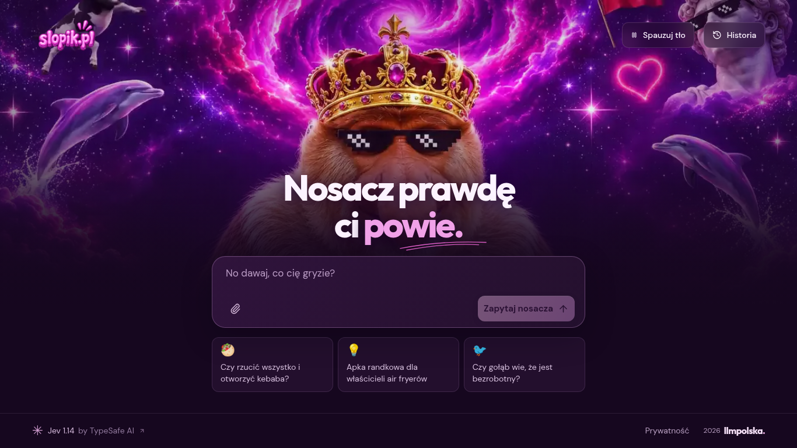

# Slopik.pl

Absurdalna polska wyrocznia AI. Zadajesz pytanie, wrzucasz pomysł albo obrazek, a nosacz wydaje werdykt.

> **Projekt for fun.** Powstał dla zabawy i eksperymentowania z AI. Odpowiedzi traktuj jak memy, nie jak poradę medyczną, prawną, finansową ani analizę biznesową.



## Co potrafi

- Krótkie werdykty dla pytań i memiczne odpowiedzi na absurd.
- Ocena pomysłu od 0 do 10, największa zaleta i wada.
- Dodawanie obrazów przez plik, przeciągnięcie lub wklejenie.
- Opcjonalna historia zapisywana tylko w Twojej przeglądarce.
- Animowany nosacz, delfiny i cały ten polski internetowy kicz. Tło można zatrzymać.

**Jev 1.14 podejmuje decyzje, nie pisze swobodnego tekstu.** Wybiera rodzaj odpowiedzi i pasujące teksty z repertuaru Slopika. Pomysły ocenia osobno pod kątem popytu, wykonalności i wyróżnika. Inspiracja: [Kill My Idea](https://github.com/monteduro/killmyidea).

## Technologie

| Część                 | Technologia                                    |
| --------------------- | ---------------------------------------------- |
| Aplikacja             | Next.js 16, React 19, TypeScript               |
| Komponenty i animacje | Radix UI, Motion, Sonner, Lucide               |
| Model                 | [Jev 1.14 od TypeSafe AI](https://typesafe.ai) |
| Hosting i API         | Cloudflare Workers                             |
| Ochrona przed botami  | Cloudflare Turnstile                           |
| Walidacja i testy     | Zod, Vitest, Playwright                        |
| Grafika i film        | ImageGen, Google Flow przez CLI gflow          |

## Uruchomienie

Wymagany Node.js 22 lub nowszy.

```sh
npm ci
cp .dev.vars.example .dev.vars
```

Uzupełnij `.dev.vars` kluczem Jev, kluczem widgetu Turnstile i jego sekretem. `SESSION_SECRET` to osobny losowy sekret do podpisywania sesji. Dla lokalnego adresu ustaw `ALLOWED_HOSTNAME=localhost` i zezwól na `localhost` w swoim widgecie Turnstile. Nie commituj `.dev.vars`.

```sh
npm run preview
```

Otwórz **http://localhost:8787**. Przy pierwszym wejściu pojawi się weryfikacja człowieczeństwa. Bez poprawnej konfiguracji API pozostaje zablokowane. Aplikacja nie podstawia udawanych odpowiedzi.

Do pracy nad UI uruchom w drugim terminalu `npm run dev`. Next działa na http://localhost:5173 i przekazuje API do lokalnego Workera. Po nowym buildzie zrestartuj podgląd Workera, aby wczytał aktualną politykę CSP.

## Prywatność i bezpieczeństwo

Slopik nie ma bazy czatów. Pytania i obrazy trafiają do TypeSafe AI w celu wydania werdyktu. Cloudflare obsługuje ruch i zabezpieczenia. Nie wysyłaj danych wrażliwych.

Historia jest domyślnie wyłączona. Po włączeniu zapisuje lokalnie do 30 rozmów, bez obrazów. Wyłączenie zapisu usuwa historię. Ustawienie pauzy tła jest zapisywane osobno.

Klucz Jev znajduje się wyłącznie w sekretach Workera. Po sprawdzeniu Turnstile serwer wydaje podpisane cookie ważne przez 30 minut, z flagami HttpOnly, Secure i SameSite. Każde wywołanie API nadal sprawdza sesję, pochodzenie żądania, rozmiar danych i limity ruchu.

Limity Cloudflare działają w poszczególnych lokalizacjach sieci. **Nie są twardym globalnym limitem wydatków.** Analiza obrazów w Jev jest eksperymentalna.

## Wdrożenie i testy

Instrukcja wdrożenia przez CLI: [docs/deployment.md](docs/deployment.md).

```sh
npm run check
npm test
npm run build
```

Przy uruchomionym podglądzie można sprawdzić interfejs przez `playwright-cli`:

```sh
playwright-cli open http://localhost:8787
playwright-cli run-code --filename tests/browser-flow.js
playwright-cli run-code --filename tests/responsive-browser.js
playwright-cli run-code --filename tests/polish-browser.js
playwright-cli close
playwright-cli open http://localhost:8787
playwright-cli run-code --filename tests/android-ui-browser.js
playwright-cli close
```

Testy zastępują odpowiedzi usług zewnętrznych wyłącznie w sesji testowej. Nie są dowodem działania prawdziwego konta Jev ani produkcyjnego Turnstile.

Pełny [spis tekstów aplikacji](docs/copy.md) i [pomiary wydajności](docs/performance.md).

Fonty DM Sans i Outfit mają licencje OFL dołączone w `public/fonts/`.
